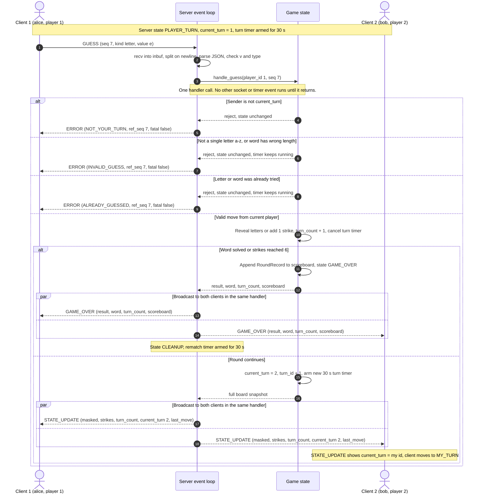
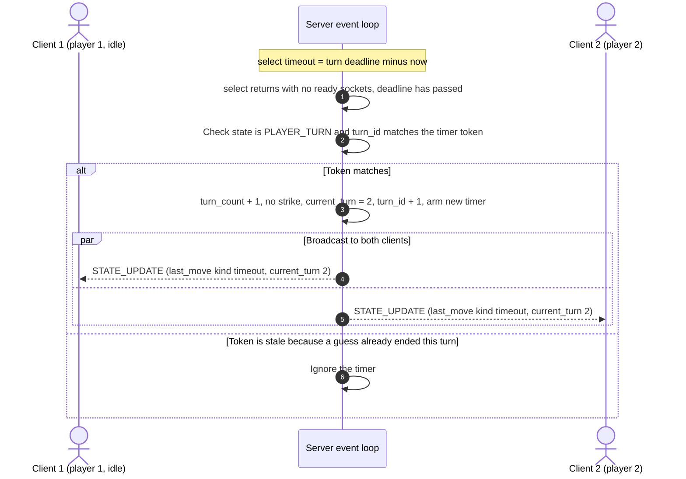
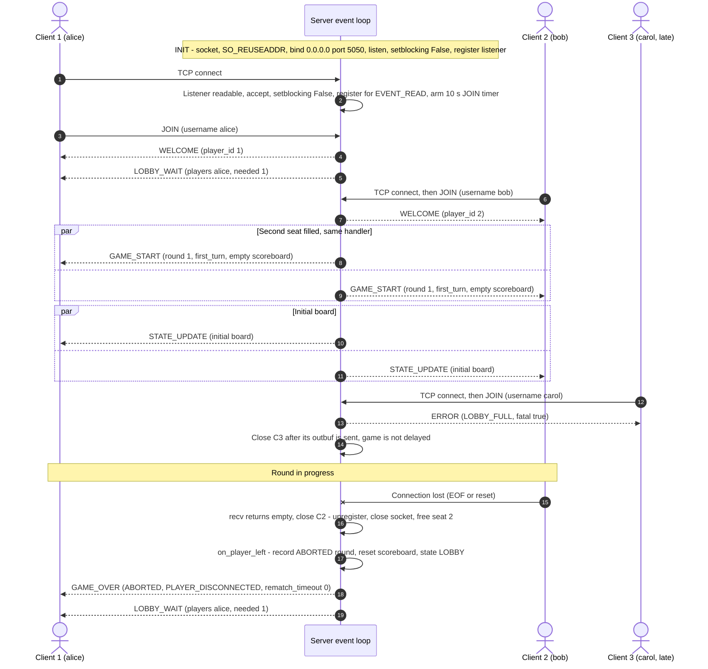

# CS 457 Sprint 2 — Game Behavior & Server Concurrency Architecture

**Student Name:** Mayur Bhat

**Date:** 2026-10-21

**Course:** CS 457 - Computer Networks

**Game:** Co-op Hangman (2 players)

**Target Server:** `server.mayur.edu` : TCP port `5050`

**Related documents:** [`protocol_blueprint.md`](protocol_blueprint.md) (message formats), [`fsm_specification.md`](fsm_specification.md) (server and client state machines)


## 1. Concurrency Model: Non-Blocking I/O Multiplexing with `selectors`

The server is a **single-threaded event loop** built on Python's `selectors.DefaultSelector`. The loop asks the OS which sockets are ready to read or write, services exactly those sockets, fires any expired timers, and repeats. No call in the loop ever blocks waiting on one client, so a slow or silent client cannot stall the other player, a new connection, or the turn timer.

### 1.1 Server data structures

```python
@dataclass
class Client:
    sock: socket.socket
    addr: tuple[str, int]
    fd: int                           # saved at accept, because fileno() is -1 after close
    inbuf: bytearray = field(default_factory=bytearray)   # bytes received, not yet split into frames
    outbuf: bytearray = field(default_factory=bytearray)  # bytes queued, not yet sent
    username: str | None = None
    player_id: int | None = None      # 1 or 2 once seated, None while unjoined
    close_after_flush: bool = False   # set after a fatal ERROR or DISCONNECT
    closed: bool = False
    last_recv: float = 0.0            # monotonic time of last received byte (liveness)

class Server:
    sel: selectors.DefaultSelector
    lsock: socket.socket               # listening socket, TCP 5050
    clients: dict[int, Client]         # fd -> Client, every open connection
    seats: dict[int, Client]           # player_id (1, 2) -> Client
    state: str                         # server FSM state: LOBBY, PLAYER_TURN, CLEANUP, ...
    game: Game | None                  # current round, see section 3.1
    scoreboard: Scoreboard             # history for the current pair of players, see section 4
    timers: dict[str, Timer]           # "turn", "rematch", "join:<fd>" -> (deadline, token)
    running: bool
```

### 1.2 The event loop

```python
MAX_FRAME = 4096

def serve_forever(self):
    while self.running:
        timeout = self.next_timer_timeout()          # seconds until the earliest deadline, or None
        events = self.sel.select(timeout)
        for key, mask in events:                     # 1) service all ready sockets
            if key.data is None:
                self.accept(key.fileobj)             # listening socket
            elif key.data is WAKEUP:
                self.drain_wakeup()                  # shutdown signal, see 2.6
            else:
                client = key.data
                if mask & selectors.EVENT_READ:
                    self.on_readable(client)
                if mask & selectors.EVENT_WRITE and not client.closed:
                    self.on_writable(client)
        self.fire_expired_timers(time.monotonic())   # 2) then fire timers that are due
    self.shutdown()
```


## 2. Connection Lifecycle


### 2.1 Listening socket (server FSM state `INIT`)

```python
self.lsock = socket.socket(socket.AF_INET, socket.SOCK_STREAM)
self.lsock.setsockopt(socket.SOL_SOCKET, socket.SO_REUSEADDR, 1)   # restart without "address in use"
self.lsock.bind(("0.0.0.0", 5050))
self.lsock.listen(8)
self.lsock.setblocking(False)
self.sel.register(self.lsock, selectors.EVENT_READ, data=None)     # data=None marks the listener
```

The word list is loaded into memory here, before the loop starts, so no file I/O happens inside the loop.

### 2.2 Accept and registration

When the listening socket is readable, `accept()` returns a new connection without blocking:

```python
def accept(self, lsock):
    try:
        sock, addr = lsock.accept()
    except BlockingIOError:
        return
    if len(self.clients) >= MAX_CONNECTIONS:   # 2 seats + 6 pending; protects against connection floods
        sock.close()
        return
    sock.setblocking(False)
    c = Client(sock, addr, fd=sock.fileno(), last_recv=time.monotonic())
    self.clients[c.fd] = c
    self.sel.register(sock, selectors.EVENT_READ, data=c)
    self.arm_timer(f"join:{c.fd}", JOIN_TIMEOUT)            # 10 s to send JOIN
```

On success the client takes the lowest free seat, the join timer is cancelled, and the server sends `WELCOME` to the new client and `LOBBY_WAIT` to everyone seated. When the second seat fills, the same handler moves the server to `GAME_START` and broadcasts `GAME_START` and the first `STATE_UPDATE`.

Because the loop never blocks, a third client connecting in the middle of a game is still serviced immediately: it gets `ERROR LOBBY_FULL` and is closed, and the running game is not delayed.

### 2.3 Reading: framing and partial reads

```python
def on_readable(self, c):
    try:
        data = c.sock.recv(4096)
    except BlockingIOError:
        return
    except (ConnectionResetError, OSError):
        return self.close(c, "RESET")
    if not data:                                       # orderly EOF from the peer
        return self.close(c, "EOF")
    c.last_recv = time.monotonic()
    c.inbuf += data
    while (i := c.inbuf.find(b"\n")) != -1:
        if i + 1 > MAX_FRAME:
            return self.fatal(c, "FRAME_TOO_LARGE")
        line = bytes(c.inbuf[:i])
        del c.inbuf[:i + 1]
        self.dispatch(c, line)                         # parse JSON, check v and type, call handler
        if c.closed or c.close_after_flush:
            return                                     # stop reading after a fatal error
    if len(c.inbuf) >= MAX_FRAME:                      # 4096 bytes and still no newline
        self.fatal(c, "FRAME_TOO_LARGE")
```

### 2.4 Writing: per-client output queues

```python
def send(self, c, msg):
    if c.closed or c.close_after_flush:
        return                                         # never write to a dead or closing client
    c.outbuf += (json.dumps(msg, separators=(",", ":")) + "\n").encode("utf-8")
    if len(c.outbuf) > MAX_OUTBUF:                     # 64 KiB: client has stopped reading
        return self.close(c, "SLOW_CONSUMER")
    self.sel.modify(c.sock, selectors.EVENT_READ | selectors.EVENT_WRITE, data=c)

def on_writable(self, c):
    try:
        n = c.sock.send(c.outbuf)                      # may send only part of the buffer
    except BlockingIOError:
        return
    except (BrokenPipeError, ConnectionResetError, OSError):
        return self.close(c, "RESET")
    del c.outbuf[:n]
    if not c.outbuf:
        self.sel.modify(c.sock, selectors.EVENT_READ, data=c)   # stop asking for EVENT_WRITE
        if c.close_after_flush:
            self.close(c, "FATAL_FLUSHED")
```

### 2.5 Teardown

Every way a connection can end goes through one function:

```python
def close(self, c, reason):
    if c.closed:
        return                                   # idempotent: safe to call twice
    c.closed = True
    self.sel.unregister(c.sock)
    c.sock.close()
    del self.clients[c.fd]
    self.cancel_timer(f"join:{c.fd}")
    if c.player_id is not None:
        del self.seats[c.player_id]
        self.on_player_left(c, reason)           # game reaction, see table below
```

| Trigger | Detected by | Server reaction |
|---|---|---|
| Client sends `DISCONNECT QUIT` | `dispatch()` | `close()`, then reaction below |
| Peer closes the socket (EOF) | `recv()` returns `b""` | `close()` |
| Connection reset or broken pipe | `recv()` / `send()` raises `OSError` | `close()` |
| No `JOIN` within 10 s | `join:<fd>` timer | `DISCONNECT IDLE`, close after flush |
| No bytes for 45 s | liveness timer | `DISCONNECT IDLE`, close after flush |
| Did not vote within the 30 s rematch window | `rematch` timer | `DISCONNECT IDLE`, close after flush |
| Fatal protocol error | `fatal()` | `ERROR` (fatal), close after flush |
| `outbuf` over 64 KiB | `send()` | `close()` immediately |
| Server shutdown (Ctrl-C) | wakeup socket | `DISCONNECT SERVER_SHUTDOWN` to everyone, flush, close all, close listener |


| Server state | Reaction |
|---|---|
| LOBBY | Seat freed, `LOBBY_WAIT` to whoever remains |
| GAME_START, PLAYER_TURN | Round ends: record it as `ABORTED`, send `GAME_OVER` (`ABORTED`, `PLAYER_DISCONNECTED` or `PLAYER_QUIT`, `rematch_timeout: 0`) to the remaining player, reset the scoreboard, move to LOBBY, send `LOBBY_WAIT` |
| CLEANUP | Rematch is impossible: cancel the rematch timer, reset the scoreboard, move to LOBBY, send `LOBBY_WAIT` to the remaining player |


## 3. State Isolation and Race-Condition Analysis

These are the resources that would need locks in a threaded design. In this design, all of them are owned by the single event-loop thread.

| Resource | Contents | Written by |
|---|---|---|
| `clients` | Every open connection (fd → `Client`) | `accept`, `close` |
| `seats` | `player_id` → `Client` for the 2 seated players | `JOIN` handler, `close` |
| `state` | Current server FSM state | All handlers that change state |
| `game.word`, `game.masked` | Hidden word and revealed pattern | `GAME_START`, `GUESS` handler |
| `game.guessed`, `game.wrong` | Correct letters, wrong letters and words | `GUESS` handler |
| `game.strikes`, `game.turn_count` | Shared strike count, turns used (the score) | `GUESS` handler, turn timer |
| `game.current_turn`, `game.turn_id` | Whose turn it is, and a counter that increases every turn | `GUESS` handler, turn timer |
| `rematch_votes` | Set of `player_id`s that voted `REMATCH` | `REMATCH` handler, `close` |
| `scoreboard` | Round history and totals for this pair (section 4) | End of round, `close` |
| `timers` | Turn, rematch, join, and liveness deadlines | Most handlers |
| `Client.inbuf`, `Client.outbuf` | Per-connection byte buffers | `on_readable`, `send`, `on_writable` |


## 4. Turn Enforcement, Score Storage, and Score Broadcast

```python
@dataclass
class RoundRecord:
    round: int
    result: str          # "WIN", "LOSE", "ABORTED"
    turn_count: int
    strikes: int
    solved_by: int | None

@dataclass
class Scoreboard:
    history: list[RoundRecord] = field(default_factory=list)

    def to_json(self):
        finished = [r for r in self.history if r.result != "ABORTED"]
        wins = [r for r in finished if r.result == "WIN"]
        return {
            "rounds_played": len(finished),
            "wins": len(wins),
            "losses": len(finished) - len(wins),
            "best_turns": min((r.turn_count for r in wins), default=None),
            "history": [asdict(r) for r in self.history],
        }
```


## 5. Sequence Diagrams



### 5.2 Turn timeout



### 5.3 Connection lifecycle, rejection, and teardown


